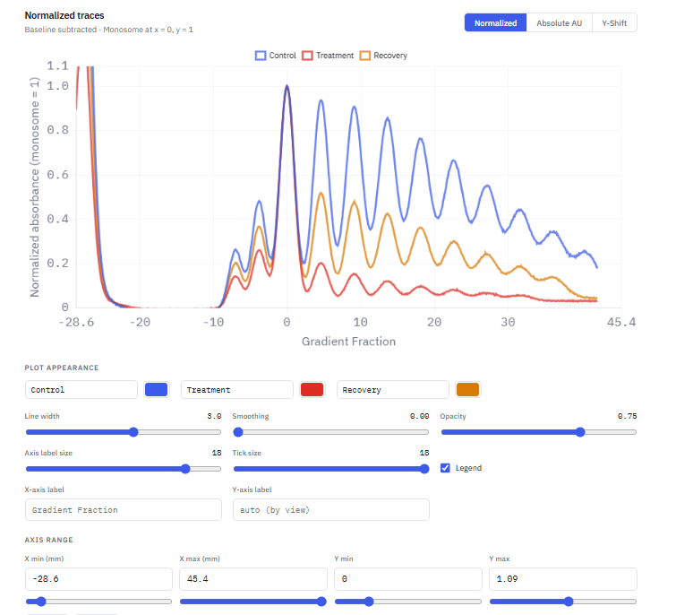
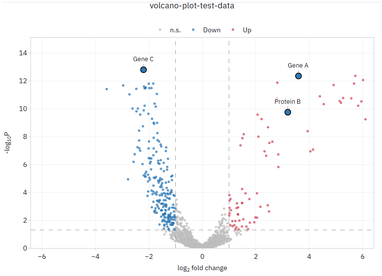
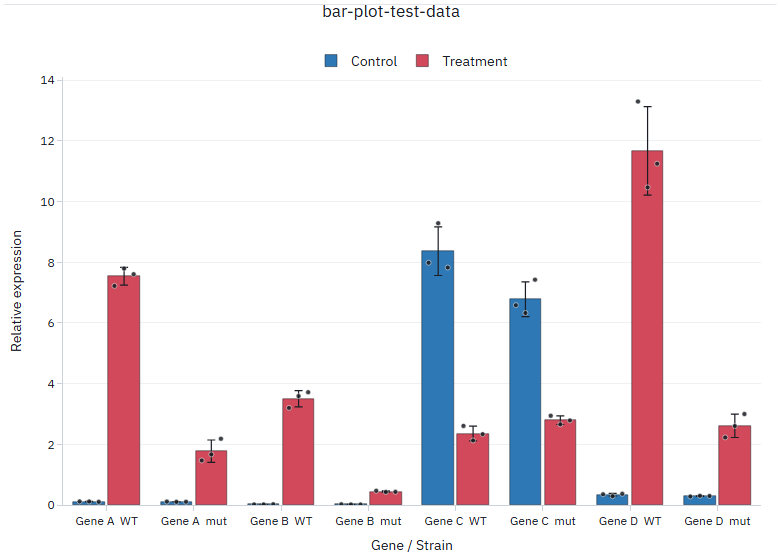

# Ribosome and RNA Wet Lab Data Plotting Tools

Three plotters for common wet-lab data, in one web page: **polysome profiles**, **volcano plots** and **bar
plots** of replicate measurements such as qPCR or dual-luciferase assays. Load a CSV, adjust the look, and
export a figure as SVG, PDF or PNG.

Download [`polysome-volcano-bar-plotter.html`](polysome-volcano-bar-plotter.html) and open it in any recent
browser. There is nothing to install.

**Your data stays on your computer.** The page reads your CSV in the browser and sends it nowhere. It needs
an internet connection only to load its chart libraries (Plotly, Chart.js, PapaParse, jsPDF, svg2pdf.js)
and fonts.

## Polysome Profiles



Upload the absorbance traces from a gradient fractionator. Each trace is baseline-corrected, aligned so its 80S
monosome peak sits at x = 0, and normalized so the monosome peak is 1.

- **Input:** pairs of columns, a position column followed by an absorbance column for each trace. The
  absorbance column's header is the trace's name:

  ```text
  Position(mm),Control,Position(mm),Treatment
  -0.47,0.3525,0.63,0.3629
  ```

- **Detection settings:** peak prominence, the minimum spacing between peaks, and the part of the gradient
  searched for the monosome (30–70% of the trace by default).
- **Views:** normalized, absolute absorbance, or traces offset vertically.
- **Export:** the aligned and normalized traces as CSV, the plot as SVG or vector PDF, or print.

## Volcano Plot



Upload differential-expression or proteomics results with one row per gene.

- **Input:** a gene column, a fold-change column and a p-value column. The plotter guesses which is which
  from the headers, and you can change its choice:

  ```text
  Gene,log2 fold change (treatment / control),p value
  Gene 1,-1.8316,8.76e-05
  ```

- **Axes:** use the values as they are, or log₂-transform the fold change and −log₁₀-transform the p-value.
- **Cut-offs:** a fold-change and a p-value threshold colour genes as up, down or not significant.
- **Genes of interest:** list them, separated by commas, to enlarge and label them. `GENE=Label` shows a
  different label, for example a protein name. Labels can be dragged.
- **Export:** PNG, SVG or PDF.

## Bar Plot



Bars of the mean with error bars and the individual replicates overlaid, for qPCR, dual-luciferase or any
other replicate measurements.

- **Input:** a Strain column and a Gene column (or one combined "Strain Gene" column), then the replicate
  values. Each treatment's name goes in the header row over its block of replicate columns:

  ```text
  Strain,Gene,,Control,,,Treatment,
  WT,Gene A,0.1194,0.116,0.1043,7.222,7.794,7.608
  ```

- **Layout:** put genes, strains or treatments on the x-axis, and group the bars by any of the other two.
  Strains, genes and treatments can be filtered and renamed.
- **Error bars:** standard deviation, standard error, 95% confidence interval, or none.
- **Significance:** brackets with p-values and stars, from Welch's t-test (two bars) or one-way ANOVA (three
  or more). With three replicates these are indicative only.
- **Export:** PNG, SVG or PDF.

## Test data

Each plotter has a file to try it with. All three are simulated: the values and the names are made up.

| file | for |
|---|---|
| [`polysome-profile-test-data.csv`](polysome-profile-test-data.csv) | Polysome Profiles: Control, Treatment and Recovery |
| [`volcano-plot-test-data.csv`](volcano-plot-test-data.csv) | Volcano Plot: 1,800 genes, treatment vs control |
| [`bar-plot-test-data.csv`](bar-plot-test-data.csv) | Bar Plot: four genes in two strains, control vs treatment, in triplicate |

## License

MIT; see [LICENSE](LICENSE).
